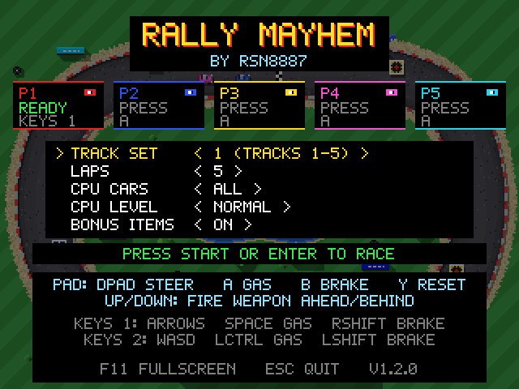
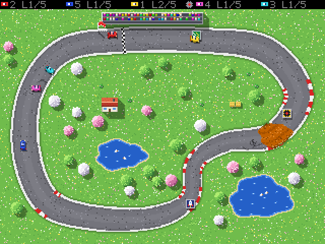

Rally Mayhem
============

A tiny top-down racing game with 1-5 local players, inspired by Grand Prix Simulator on the Amstrad CPC and Rally Cross Challenge on the Amiga.

Every track fits on a single 320x240 screen. There are 30 tracks with many themes such as summer, spring, city, village and many more. CPU cars fill the grid, collisions are pixel-exact, and bonus items can be fired ahead or behind. Steer with the D-pad, accelerate with A, brake with B, and press Y to put a stuck car back on the track.




How to build
---------------

- Switch:
```
docker run -it -v "$(pwd)":/app -w /app devkitpro/devkita64
cmake -S ./rallymayhem -B build-switch -DPLATFORM=SWITCH
cmake --build build-switch -j
```
This creates `build-switch/rallymayhem.nro`, which you copy to the `switch` folder on the SD card.

- PS Vita (needs custom firmware, e.g. HENkaku/Ensō; VITASDK must be set):
```
docker run --rm -it -v "$PWD:/workspace" vitasdk/vitasdk:2026.08
cd /workspace
cmake -S ./rallymayhem -B build-vita -DPLATFORM=VITA
cmake --build build-vita -j
```
This creates `build-vita/RallyMayhem.vpk`, which you install with VitaShell. If SDL2 or SDL2_ttf are missing from VitaSDK, run `vdpm sdl2 sdl2_ttf`.

- Linux x64 (Docker, also works on an Apple Silicon Mac):
```
docker build --platform linux/amd64 -t rallymayhem-linux-x64 ./rallymayhem/docker/linux-x64
docker run --rm --platform linux/amd64 -v "$(pwd)":/app -w /app rallymayhem-linux-x64 \
  sh -c "cmake -S ./rallymayhem -B build-linux && cmake --build build-linux -j"
```
This creates `build-linux/rallymayhem` with its `assets` folder next to it. To run it, the target system needs SDL2 and SDL2_ttf installed (e.g. `sudo apt install libsdl2-2.0-0 libsdl2-ttf-2.0-0`).

- Linux ARM64 (e.g. Raspberry Pi 4/5 with 64-bit Raspberry Pi OS; Docker, runs natively on an Apple Silicon Mac):
```
docker build --platform linux/arm64 -t rallymayhem-linux-arm64 ./rallymayhem/docker/linux-arm64
docker run --rm --platform linux/arm64 -v "$(pwd)":/app -w /app rallymayhem-linux-arm64 \
  sh -c "cmake -S ./rallymayhem -B build-linux-arm64 && cmake --build build-linux-arm64 -j"
```
This creates `build-linux-arm64/rallymayhem` with its `assets` folder next to it. On the Pi, install SDL2 and SDL2_ttf with `sudo apt install libsdl2-2.0-0 libsdl2-ttf-2.0-0`.

- Android (Docker; for Android handhelds with built-in controls, e.g. AYANEO Pocket Air Mini, Retroid Pocket, Anbernic, or a phone with a controller):
```
docker build --platform linux/amd64 -t rallymayhem-android ./rallymayhem/docker/android
docker run --rm --platform linux/amd64 -v "$(pwd)":/app -w /app -v rallymayhem-gradle:/root/.gradle rallymayhem-android \
  sh ./rallymayhem/android/build.sh build-android
```
This creates `build-android/RallyMayhem-1.2.0.apk` (arm64, armv7 and x86-64), which you copy to the device and install (allow installing from unknown sources). The first build downloads the Gradle plugins into the `rallymayhem-gradle` volume, so later builds are faster. The first build also creates `build-android/rallymayhem-release.keystore`, the key the APK is signed with. Keep it, because an installed APK can only be updated by one signed with the same key. The game needs a gamepad or built-in controls; there are no touch controls. On Apple Silicon Macs the image runs under x86-64 emulation, because the Android NDK only exists for x86-64 Linux.

- MacOS:
```
brew install cmake sdl2 sdl2_ttf
cmake -S ./rallymayhem -B build
cmake --build build -j
open build/RallyMayhem.app
```
To make a `.dmg` for sharing, run `./rallymayhem/make_dmg.sh`. It builds into `build-macos/` and puts the SDL libraries into the app, so it runs on Macs without Homebrew. The result is `build-macos/RallyMayhem-1.2.0-macOS-arm64.dmg`. The app is signed ad hoc, so the first time it has to be opened with right-click > Open.

- Windows:
Install MSYS2 MinGW, then open a msys2 ucrt shell
```
pacman -S mingw-w64-ucrt-x86_64-gcc
pacman -S mingw-w64-ucrt-x86_64-cmake
pacman -S mingw-w64-ucrt-x86_64-SDL2
pacman -S mingw-w64-ucrt-x86_64-SDL2_ttf
cmake -S ./rallymayhem -B build && cmake --build build -j
curl https://raw.githubusercontent.com/rollerozxa/msys2-bundledlls/master/bundledlls > ./bundledlls
bundledlls ./rallymayhem.exe ./
```

All commands are run from the folder that contains the `rallymayhem` project folder, so the build folders end up next to it.

Controls
--------

| | Game controller | Keys 1 | Keys 2 |
|---|---|---|---|
| Steer | D-pad / left stick | Left / Right | A / D |
| Accelerate | A (or right trigger) | Space or Right Ctrl | Left Ctrl |
| Brake / reverse | B, X (or left trigger) | Right Shift | Left Shift |
| Fire weapon ahead | Up | Up | W |
| Fire weapon behind | Down | Down | S |
| Put car back on track | Y | Backspace | Q |
| Pause | Start | Enter | |
| Quit | Back | Esc | |

On the title screen press accelerate to join (brake leaves) and pick the track set, laps, CPU cars (ALL fills every free slot, or pick a number, or OFF), the CPU level (easy, normal, hard) and bonus items (on by default) with up/down/left/right. With bonus items on, each pick-up tile shows the weapon it holds. Press accelerate just as the start light turns green for a turbo start. While paused, brake quits the race. On desktop, F11 toggles fullscreen. On the PS Vita the buttons are Cross (accelerate), Circle (brake) and Triangle (reset); on the Switch, + or - pauses.

The 30 tracks are played in sets of five: track set 1 is tracks 1-5, track set 2 is tracks 6-10, and so on, and "complete" plays all 30 in sequence. Each race awards points (10, 6, 4, 2, 1) and is followed by the next track; after the last track of the set the cup winner is shown, and the title screen comes back with the next track set selected.

Source files
------------

| File | Contents |
|---|---|
| `src/main.cpp` | program entry, window and main loop, developer tools |
| `src/game.cpp` | input devices, race flow, HUD, title and results screens |
| `src/cars.cpp` | car physics, collisions, CPU drivers, weapons, moving track parts |
| `src/level.cpp` | building a track: roads, themes, scenery, lighting |
| `src/draw.cpp` | drawing the track, cars, weather and lighting |
| `src/gfx.cpp` | frame buffer helpers and text |
| `src/synth.cpp` | sound synthesizer |
| `src/tracks.cpp` | the 30 tracks |
| `src/game.h`, `src/tracks.h`, `src/synth.h` | shared declarations, the track format, the sound interface |

Adding tracks
-------------

Tracks are in `src/tracks.cpp`: a closed spline of control points `{x, y, width, height, flags}`, a theme, the weather and a list of scenery objects. Cars are 9x5 pixels and a normal road is about 24 wide. The flags and object types are described in `src/tracks.h`; trees, houses and other scenery that suit the theme are scattered automatically.

Credits
-------

- Font: an original 5x7 pixel font, generated by `tools/makefont.py` (needs Python with fontTools).
- Graphics and sound: generated by the program at runtime.
- Libraries: [SDL2](https://www.libsdl.org) and SDL2_ttf (zlib license), FreeType.
- Inspired by Grand Prix Simulator (Amstrad CPC) and Rally Cross Challenge (Amiga). This is an unaffiliated fan homage.

assisted by Claude
